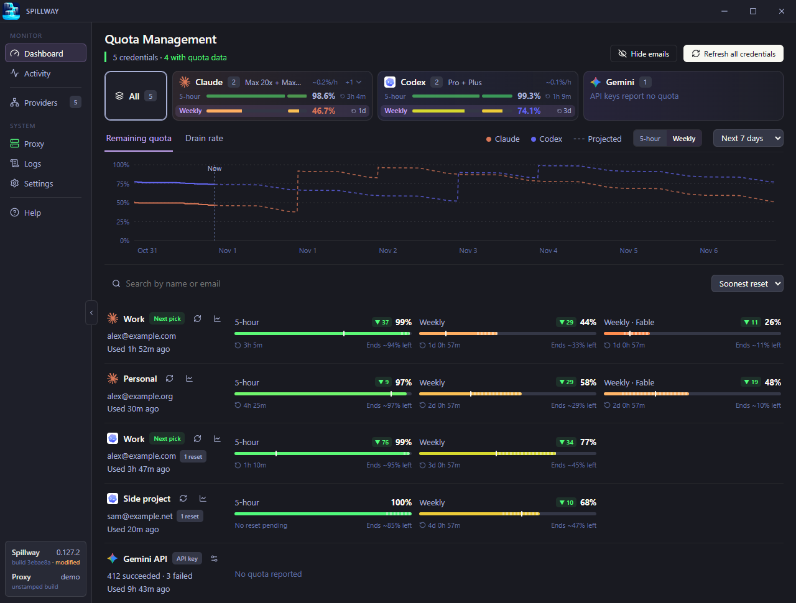
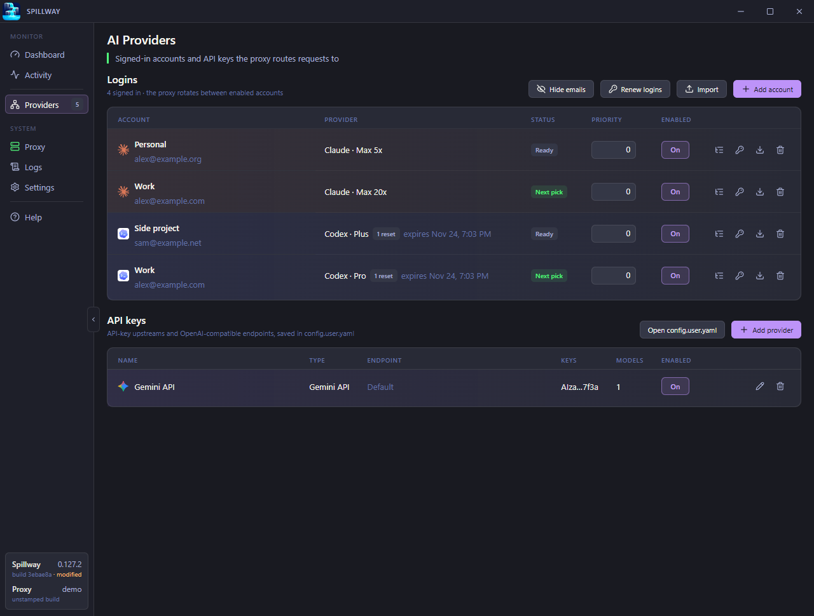
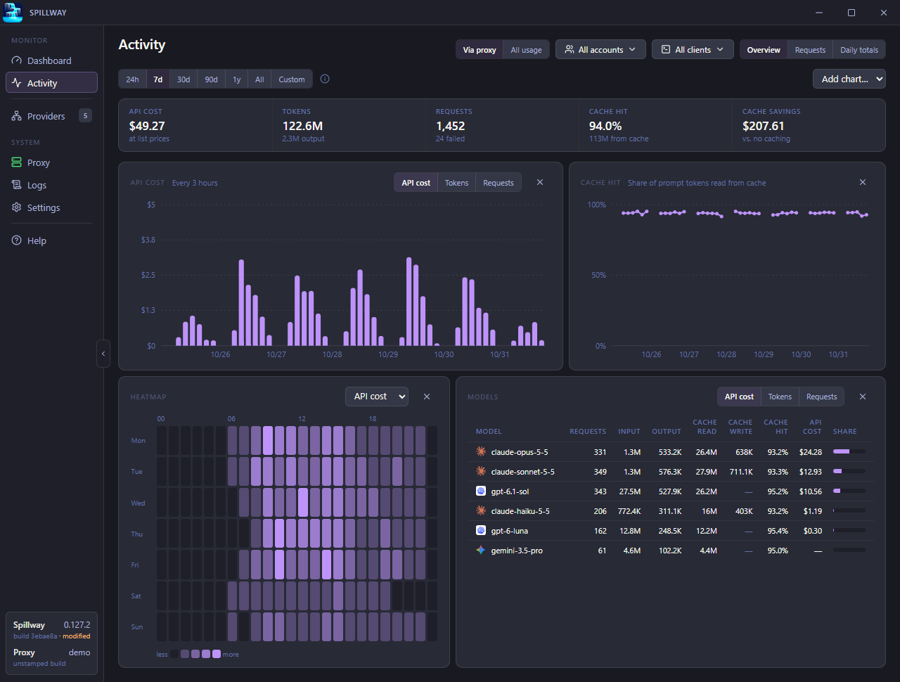

# Spillway

Windows and macOS tray (menu bar) app that runs a local AI proxy (the CLIProxyAPI fork), pools your subscription accounts behind it, and shows how much of each account's limits is left.

<picture>
  <source media="(prefers-color-scheme: light)" srcset="docs/images/dashboard-light.png">
  
</picture>

> **Read [Security and terms](docs/security.md) first.** Pooling subscription accounts may break a provider's terms, and anyone with the client key can spend every pooled account's quota.

## Install

Download the installer from [Releases](https://github.com/Cujuju/spillway/releases): `Spillway-Setup-<version>.exe` on Windows. On macOS the app is ad-hoc signed, so Gatekeeper blocks a downloaded copy; [build it on your Mac](docs/setup.md#macos).

## Quick start

1. Open Spillway. The proxy starts with the app.
2. **Providers → Add account**: pick the provider and sign in through the browser. Repeat for each account.
3. **Proxy → Connect clients → Apply** for Claude Code and Codex, then restart any client that is running.
4. Use Claude Code or Codex as usual. Requests spread across your accounts; the **Dashboard** shows what is left.

<picture>
  <source media="(prefers-color-scheme: light)" srcset="docs/images/providers-light.png">
  
</picture>

Logins: Claude (Pro/Max), Codex (ChatGPT Plus/Pro), Antigravity (Google), xAI (Grok), Kimi, Kimi.ai, Devin, Muse (Meta). API keys and OpenAI-compatible endpoints go under **Providers → API keys**.

## Pages

| Page | What it does |
|---|---|
| **Dashboard** | Quota left per provider and account (5-hour, weekly and model limits), reset times, drain rate and a forecast chart. Refresh one account or all; spend a Codex reset credit. |
| **Activity** | Cost at list prices, tokens, cache hits, a heatmap and per-model totals; every request live (**Requests**) and per day (**Daily totals**). **All usage** adds requests read from Claude Code's and Codex's local logs. |
| **Providers** | Add, import, export, renew, disable or remove logins; set priority and a note. Add API-key upstreams. |
| **Proxy** | Endpoint and client key, **Apply**/**Undo** per client, custom proxy settings (`config.user.yaml`), management lockouts. |
| **Logs** | The proxy's output. **Record all requests** saves full requests and responses, prompts included, until you turn it off. |
| **Settings** | Startup, theme, tray icons, notifications, routing, window starts, updates, data folders and history. |
| **Help** | The routing how-tos below. |

<picture>
  <source media="(prefers-color-scheme: light)" srcset="docs/images/activity-light.png">
  
</picture>

## Tray menu

**Use account** sends all of a provider's traffic to one account until you pick **Automatic**. The menu also opens the window, starts, stops or restarts the proxy, refreshes usage and quits. Optional limit icons each show one number (Settings → Tray icons).

## Routing

The proxy uses the account whose limit resets **soonest** (Settings → Routing & server → Routing strategy). **Session affinity** keeps each conversation on its account, so its prompt cache stays warm. When an account is limited, new conversations go to the next one.

| To | Do | Effect |
|---|---|---|
| Send new conversations to one account | Providers: raise its **Priority** | Running conversations stay put |
| Send everything to one account | Tray → **Use account** | Running conversations move; their cache starts over |
| Move one conversation | Activity → Requests → **Move…** | It and its subagents move; its cache starts over |
| Stop using an account | Providers: turn off **Enabled** | Its conversations move at their next request |

Also under Routing & server: **Wait for a near reset** (off by default) holds a conversation when its account resets soon, instead of moving it; **On server errors** retries on the same account (keeps the cache) or switches. **Window starts** (Settings, off by default) starts an account's next 5-hour window as soon as the last one resets, so it resets sooner.

## Connect clients

**Apply** edits each client's own config and keeps a backup; **Undo** restores it.

- **Claude Code** (`~/.claude/settings.json`): the endpoint, and the client key as a header. Stay signed in to Claude Code; requests still use the pooled accounts.
- **Codex** (`~/.codex/config.toml`): points Codex's built-in OpenAI provider at the proxy. Sign Codex in to one of the pooled Codex accounts.
- Changing the port or key marks a client **Out of date**: **Re-apply**. Settings → Routing & server → **When client settings change** warns about outside edits to these settings, or puts them back.
- Shell variables, T3 Code and Claude Code's machine-wide managed settings: steps on the Proxy page.

Exactly what Apply changes: [Connect clients](docs/clients.md).

## Updates

Settings → Updates: **Stable** or **Nightly**, checked a minute after launch and every 6 hours. Nothing downloads until you click **Download**, then **Restart and install**. Every update's signature is checked first.

## Privacy

**Show emails** off (Dashboard button, or Settings → Dashboard) hides every account's username (`•••@example.com`) in the window, tray and notifications. Request history keeps metadata only (account, model, tokens, timing); prompts are saved only for failed requests and while **Record all requests** is on. Folders and history: Settings → Advanced, or [Data](docs/data.md).

## Troubleshooting

| Problem | Fix |
|---|---|
| Proxy shows **Port in use** | Close the other program, or change Settings → Routing & server → Port, then re-apply clients |
| Proxy keeps crashing | Check Logs. It stops restarting after 5 crashes in 10 minutes |
| A client ignores the proxy | Restart it after Apply (in T3 Code, start a new session) |
| An outside tool is locked out | Proxy → Management lockouts → **Reset** |
| An account shows an error | Providers: renew its login, or sign in again |

## More

- [Security and terms](docs/security.md): provider terms, what each secret unlocks, network exposure.
- [Build and run](docs/setup.md): build from source, dev builds, the fake-data demo, macOS.
- [Connect clients](docs/clients.md): file-level details of Apply and Undo.
- [Updates and releases](docs/releasing.md): update signing, nightly and stable releases.
- [Data](docs/data.md): files, folders and the management key.

Provider logos: [lobe-icons](https://github.com/lobehub/lobe-icons) (MIT). Screenshots show fake data (`pnpm demo --screenshots`).
